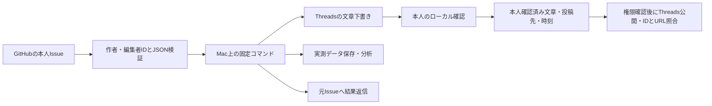

# 構成と安全制御

## 状態

`awaiting_review`（確認待ち）→ `approved`（下書き承認）→ `scheduled`（ローカル予約検証）→ `simulated`（公開せず終了）。制作失敗は `failed`。
`published` は所有照合済みの既存投稿、または新規Threads文章のID・URL・本文・所有を照合した記録に使います。
Threads文章では `creating` → `container_ready` → `publishing` → `verification_required` → `published` を実装しました。POST送信前に永続化し、応答不明は `reconciliation_required` で停止します。現在は投稿権限と初回本人確認が未完了のため無効です。

- 管理ID：`moco-` + ランダム16桁。媒体とコンテンツのSHA-256指紋に一意制約。
- 保存：SQLite WAL / synchronous=FULL、単一実行のOSファイルロック。状態・操作イベント・Issue処理台帳・実測を保存。
- 承認：Threadsは原稿JSONとpost.txtをハッシュ化し、本文・数値の投稿先ID・時刻を専用台帳に固定します。改訂・欠落・差し替えは公開不可。動画用の過去の仕組みも保持していますが、動画生成は無効です。
- 再試行：ローカル制作だけを指数バックオフで最大3回。HTTPのGETだけ429/5xx/通信失敗を最大3回。POSTは自動再送しない。
- 停止：`var/STOP`。ロック取得を待たず停止設定でき、再開はローカル専用。実行中のローカル制作は完了することがあります。
- 予約：明示的なタイムゾーン付きISO 8601必須。UTC保存。Macがスリープしていた時間は起床後に検知します。公開時刻保証は未対応。

## GitHub指示の信頼境界

リポジトリはコード内で固定。本人の数値IDをローカル設定へ固定。指定ラベルのopen Issueだけを受信します。
RESTの作者IDだけで信頼せず、GraphQLで本文一致・作者・最終編集者も確認します。確認不能時は実行しません。
コマンドは定義済みのキー・型・文字数・媒体を検査し、任意のURL取得やファイルパス、シェルを受け付けません。
Issue IDとコマンドUUIDを二重に一意管理し、実行前に予約記録します。再起動やIssue本文変更で既存指示を再実行しません。
クラッシュで `running` のまま残った指示は自動再実行せず、本人が状態を照合します。
報告失敗は結果をローカルに保持。元Issueのコメントマーカーを照合して返信を再試行します。GitHub側にコメントの冪等性キーがないため、異常時のコメント重複を完全には保証しません。

## 秘密値とログ

Metaトークン・YouTubeリフレッシュトークンはmacOS Keychain。SwiftのSecurity APIへ標準入力で渡し、プロセス引数へ秘密値を載せません。
Threads投稿用は別の専用ヘルパーとKeychainキー `threads_publish` を使用し、既存読取キーを扱えない構成です。新規追加だけで上書き・削除機能はありません。
GitHubは既存Git認証ヘルパー、または `gh` のKeychain認証をプロセス内で使用します。
秘密値付きURL、HTTP、未知のAPIホスト、認証ヘッダを含むリダイレクトを拒否。TLSはOS/Pythonの検証付きSSLコンテキストを使用します。
HTTPのレスポンス本文・例外・認証情報はログに出さず、固定エラーコードだけを出します。
`var/` は所有者のみアクセス可能なディレクトリです。ログ・DB・動画・個別実績はGitへ送信しません。

## 現段階の限界

LLM・有料素材サービスは未接続です。企画案・原稿はローカルテンプレートから作成し、本人が修正します。本人の声・顔・体験は合成していません。
Threads文章用公開処理は模擬検証済みですが、実公開は未検証です。投稿権限の追加と本文・投稿先・時刻の本人確認後に有効化します。
Metaの認証開始・更新の自動化、Threads専用の自動結果報告、異常通知は次段階です。動画と他媒体の新規制作・投稿は本人指示で休止しています。
